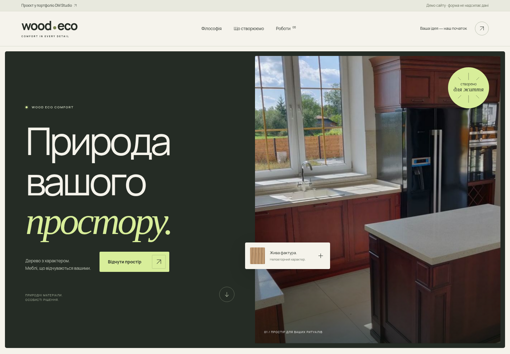
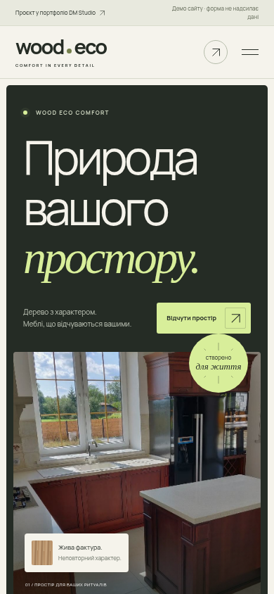
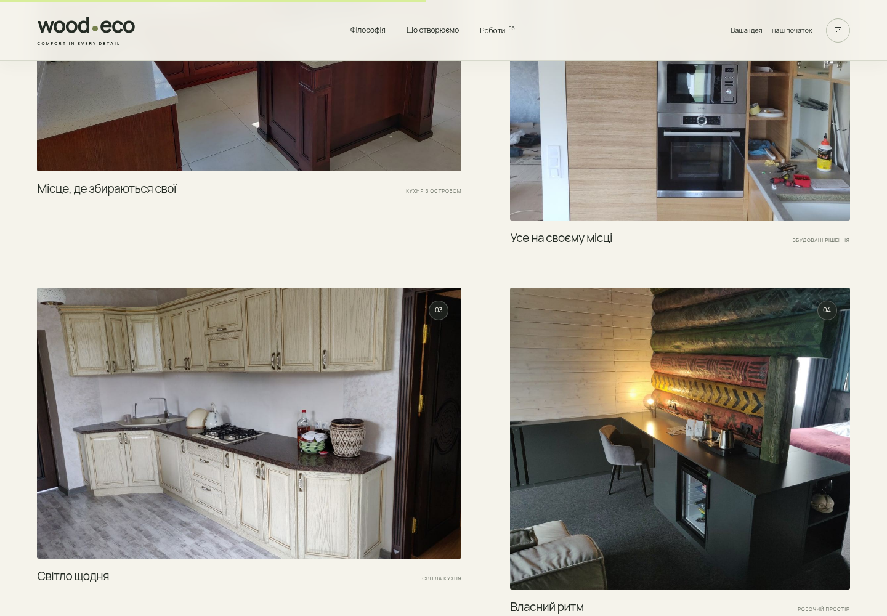

# WOODECO — motion redesign

Повний редизайн демо за адресою `/demos/woodeco/`: нова композиція, типографіка, оливкова палітра з лаймовими акцентами та оригінальні фотографії WOODECO.

## Перегляд



| Мобільна версія | Галерея реальних робіт |
| --- | --- |
|  |  |

[Відео взаємодії та анімацій](motion-preview.mp4)

## Що змінено

- Новий wordmark, навігація, велика типографіка та hero з фотографією реальної роботи.
- Плавна поява заголовка, паралакс фотографій, проявлення слів під час прокручування, поява секцій та hover-переходи.
- Інтерактивні напрями з окремими фото та вибором потрібного типу запиту.
- Асиметрична галерея з фільтрами та повноекранним переглядом. Стрілки перемикають лише фото поточного фільтра.
- Блоки філософії, матеріалів, процесу, нова контактна форма та великий типографічний footer.
- Мобільне меню, керування фокусом і клавіатурою, режим `prefers-reduced-motion`, кнопка паузи для декоративного рядка.
- Форма перевіряє введення, готує текст запиту та копіює його. Мережевих надсилань немає; це явно вказано біля форми.

## Запуск

```bash
npm ci --cache /workspace/.npm-cache
npm run dev -- --host 0.0.0.0
```

У Vite development відкривайте `/demos/woodeco/index.html` — маршрут без `index.html` потрапляє у fallback головного сайту.

```bash
npm run check
npm run build
npm run preview -- --host 0.0.0.0
```

Після збірки відкривайте `/demos/woodeco/`. Production static handler перевірено на цьому самому маршруті.

## Перевірки

`npm run check` та `npm run build` пройшли. Chromium: 12 перевірок пройшли, без помилок JavaScript і відсутніх ресурсів. Зокрема перевірено таби, фільтри, lightbox, Escape, повернення фокуса, мобільне меню, підготовку/копіювання запиту без POST-запитів, відсутність горизонтального overflow на 320/390/768/1440 px, зменшений рух та видимість основного вмісту без JavaScript. Деталі — у [validation.json](validation.json).

Шрифти Manrope локальні, ліцензія додана у `public/demos/woodeco/fonts/`. Зовнішніх бібліотек анімації, нових npm-залежностей і згенерованих фотографій немає. Зміни обмежені WOODECO та цією документацією. Гілка призначена для перегляду; публікація на Railway потребує окремого застосування змін у production.
